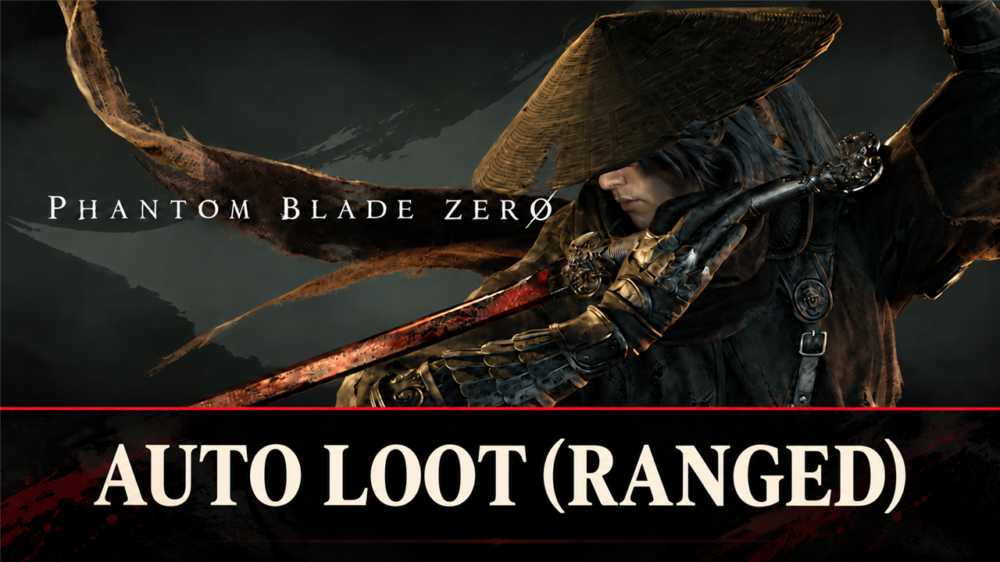

# Auto Loot (Ranged)

Loot piles near you are picked up by themselves from a short distance. Range, chests and loot types are set in config.lua, live in game.

## What it does

Walk past loot and it is yours: loot piles near you are picked up by themselves, without stepping right onto them.

- Loot piles, notes and pages within 4 m (a setting, `Range`) are picked up one after the other, the nearest first:
  a little before the game's own prompt shows up (2.5 to 3.5 m).
- A chest opens by itself when the game's own prompt shows on it, as if you had pressed the key. Chests never open
  from a distance: their opening animation brings you to the chest.
- The game does the pickup: the same bag, popup and save as after a key press.
- Settings change live: edit `config.lua`, save, and the game uses them within a few seconds.

What stays for you (a key press as in the game):

- Piles with a weapon, medicine or accessory (the game's equip or replace choice). Chests with gear open.
- Story and quest items: narrative items, memory flowers and petals, items that set a quest flag.
- Scripted loot (its own event or cutscene) and locked chests (they spend a key item).
- In mode `Materials` or `Common`, everything that is not a material, and all chests.

Nothing is taken in combat, in the air, during an attack or a status effect, while the game is paused, in dialogue, in
a cutscene, or while the pickup popup is open.

It is a UE4SS Lua script: it calls the game's own pickup while the game runs. It replaces no game file and does not
touch your save.

## Screenshots

## How to install

1. Install UE4SS for Phantom Blade Zero, for example [UE4SS](https://github.com/KintaroModding/ue4ss) (its zip
   `phantombladezero_ue4ss_<version>.zip`: the official UE4SS build with a config that makes it run in this game).
2. Download the zip of the latest release on GitHub (`phantombladezero_autolootranged_<version>.zip`).
3. Unpack it into the game folder `platform\steam\`, next to the game's exe. It adds the folder
   `ue4ss\Mods\phantombladezero_autolootranged\` (with the file `enabled.txt`, UE4SS starts it by itself).
4. Start the game.

To check that it runs: `platform\steam\ue4ss\UE4SS.log` has the line `[Auto Loot (Ranged)] <version> loaded.`

To update the mod, replace the folder with the one of the new release; to keep your settings, put your old
`Scripts\config.lua` back (a setting that it does not have keeps its default). To remove it, delete the folder
`ue4ss\Mods\phantombladezero_autolootranged\`.

## How to use

Nothing to do: walk near loot. Loot that stays for you shows the game's prompt as usual.

## Settings

The settings are in `platform\steam\ue4ss\Mods\phantombladezero_autolootranged\Scripts\config.lua`. Open it with a
text editor, change a value and save: the mod reads the file every 5 seconds, so you see the change in the game
without a restart. A file it cannot read (for example a typo) keeps the last settings. `UE4SS.log` shows the settings
in use in the line `[Auto Loot (Ranged)] Settings: ...`, and names each value it could not use.

| Setting | Default | What it does |
|---|---|---|
| `Enable` | `true` | `false`: the game as normal, every pickup by a key press |
| `Range` | `4` | Metres around you in which loot piles are picked up by themselves (0.5 to 10) |
| `Chests` | `true` | `true`: a chest opens by itself when the game's prompt shows on it (only in mode `All`) |
| `Mode` | `"All"` | `"All"`: piles, notes and chests. `"Materials"`: only piles that hold nothing but materials, no chests. `"Common"`: like `"Materials"`, but only materials with a white or pale blue glow; purple and orange ones stay for you |
| `LogDetail` | `false` | `true`: `UE4SS.log` lists each pickup, each pile left for you and why (for tests) |

## Compatibility

- Game version: Release (Steam build 26266538) (`CL-301524_JKS-17219`).
- Tested with UE4SS `v3.0.1-1188-gf885e8d2`.
- Works with [Loot Glow Amplified](https://github.com/KintaroModding/phantombladezero_lootglowamplified): a taken pile
  stays dark.
- Another auto loot mod that replaces the game's `InteractionUI.js` would pick up the same loot: use only one of them.

## Known issues

- A pile behind a thin wall within `Range` is picked up too: the mod measures the distance, not the way to it.

## How to build

There is nothing to build: `src\phantombladezero_autolootranged\Scripts\main.lua` is the mod. `tests\test_main.py` runs the script
outside the game with Lua 5.4 ([lupa](https://pypi.org/project/lupa/)) and mocks of UE4SS:
`python tests\test_main.py`. `README.md` has the details.

## Credits

Made by Kintaro. MIT license: you may use, change and share this mod. UE4SS is made by the
[UE4SS-RE team](https://github.com/UE4SS-RE/RE-UE4SS). Phantom Blade Zero belongs to its makers.
